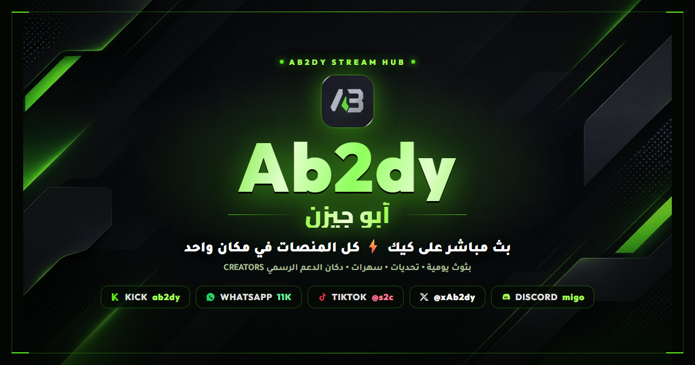
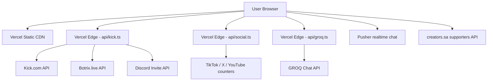

<p align="center">
  
</p>

<h1 align="center">⚡ Ab2dy Stream Hub</h1>

<p align="center">
  <strong>— منصة Ab2dy الشاملة للبث المباشر والتفاعل والمجتمع —</strong>
  <br>
  <em>The Ultimate Streaming Command Center for Ab2dy • Kick • Neon Eternity • Community</em>
</p>

<p align="center">
  
  
  
  
  
  
  
</p>

<p align="center">
  <a href="https://kick.com/ab2dy">🎮 Kick</a> •
  <a href="https://www.tiktok.com/@s2c">🎵 TikTok</a> •
  <a href="https://x.com/xAb2dy">🐦 X</a> •
  <a href="https://discord.com/invite/migo">🎧 Discord</a> •
  <a href="https://www.whatsapp.com/channel/0029Vajy8hQ2ZjCs85K37d3y">💬 WhatsApp</a>
</p>

---

## ✨ المميزات — Features

<table>
<tr>
<td width="50%" valign="top">

### 📺 Live Streaming
- **Kick Embed** player with low-latency HLS.js
- Auto-reconnect on stream drop
- Dual-view: featured section + sidebar
- Cinema mode for immersive watching

### 🤖 AI Chat — أبو فهدة
- **GROQ-powered** with Saudi dialect, served through `/api/groq` so keys stay server-side
- Custom Kick emotes rendering (`[emote:ID]`)
- Social link buttons (`[social:platform:count:url]`)
- **Botrix integration** for leaderboard queries
- Key rotation `GROQ_API_KEY_1 → _2 → _3` inside one request when a key is rate-limited

### 📊 Live Social Stats
- Real-time follower counts (Kick, YouTube, TikTok, X, Snapchat, WhatsApp)
- Animated stat cards with platform colors
- Automatic refresh every 60 seconds

</td>
<td width="50%" valign="top">

### 🏆 Botrix Leaderboard
- Top supporters ranked by watchtime
- Level, XP, and points per user
- Profile avatars from Kick API
- Sorted by leaderboard ranking

### 🎬 Media & Content
- **Highlight Clips** gallery (YouTube/TikTok)
- **Studio Section** — community submissions with approve/reject moderation
- **Media Library** — image/video/link assets

### 📋 Community Tools
- **📢 Announcement Bar** — scrolling ticker
- **📅 Stream Schedule** — weekly plan toggle
- **❓ FAQ Section** — expandable Q&A
- **💰 Sponsors & Promo Codes** — one-click copy
- **📊 Live Polls** — real-time voting

### 🔐 Admin Dashboard
- **Full RBAC** — admin/editor/viewer roles
- **SEO Settings** — title, description, keywords
- **Audit Logs** — full activity trail
- **AI Chat Logs** — view all conversations
- **Studio Review** — approve/reject submissions
- **Media Manager** — upload & organize assets

</td>
</tr>
</table>

---

## 🛠 Architecture — البنية التقنية



| Layer | Technology | Purpose |
|-------|-----------|---------|
| **Frontend** | React 19 + TypeScript + Vite 6 | SPA with instant HMR |
| **Styling** | Tailwind CSS (utility-first) + hand-written neon CSS | Responsive, dark-theme UI |
| **State** | React hooks + `sessionStorage` caches | Live data with TTL refresh |
| **API Proxy** | Vercel Edge Functions (`api/kick`, `api/social`, `api/vod`) | CORS-free fetching + `s-maxage` caching |
| **AI** | GROQ via `api/groq.ts` | Chat assistant, keys never reach the browser |
| **Realtime** | Pusher (`services/chatService.ts`) | Live chatroom messages |
| **Supporters** | creators.sa public API | Donation leaderboards |
| **Hosting** | Vercel (static + serverless) | GitHub Pages works for the static shell only |

---

## 📁 Project Structure — هيكل المشروع

```
Ab2dy/
├── api/                          # Vercel Edge Functions
│   ├── kick.ts                   #   Allowlisted proxy: kick.com / discord.com / botrix.live
│   ├── social.ts                 #   TikTok / X / YouTube follower counters (4-min CDN cache)
│   ├── vod.ts                    #   Kick VOD -> m3u8 resolver
│   └── groq.ts                   #   GROQ chat with GROQ_API_KEY_1/2/3 rotation
├── components/
│   ├── SiteHeader.tsx             #   Floating neon dock (brand, nav, live badge, lang)
│   ├── StreamPlayer.tsx           #   Kick embed + HLS cinema mode
│   ├── VodTheater.tsx             #   Lazy-loaded VOD/clip modal (pulls hls.js on demand)
│   ├── CommunityWidgets.tsx       #   Discord guild + X feed cards
│   ├── StatsSection.tsx           #   Live stats, Botrix board, clip grid
│   ├── BotrixLeaderboard.tsx      #   Top supporters table
│   ├── PublicWidgets.tsx          #   Schedule, FAQ, sponsors
│   ├── Chat.tsx / AIChat.tsx      #   Pusher chatroom + GROQ assistant
│   ├── SocialMediaAdmin.tsx       #   Social counter editor (legacy PHP panel)
│   └── Icons.tsx                  #   Inline SVG platform icons
├── services/chatService.ts        # Pusher connection, roles, emote parsing
├── utils/                         # kickApi / socialMediaApi / supportersApi (TTL caches)
├── public/
│   ├── og-ab2dy.png               #   1200x630 link-preview card (rendered from tools/og-card.html)
│   ├── bg-ab2dy.webp              #   Neon HUD plate, 42 KB
│   ├── ab2dy-logo.webp            #   Logo + favicon + maskable manifest icon
│   ├── creators-ab2dy.webp        #   CREATORS tip-store mark
│   ├── site.webmanifest           #   PWA manifest (RTL, standalone, neon theme)
│   ├── sitemap.xml · robots.txt
│   └── album/                     #   Photo pool for the unmounted AlbumSection
├── tools/og-card.html             # Source of the OG image — edit, screenshot, commit
├── App.tsx                        # Single-page app: sections, i18n (ar/en), data wiring
├── index.html                     # SEO head (OG/Twitter/JSON-LD/hreflang) + all custom CSS
├── vercel.json                    # Framework, SPA rewrites, cache & security headers
├── vite.config.ts                 # Dev server + /api/kick dev proxy
└── package.json                   # Scripts, deps, engines: node 22.x
```

---

## 🚀 Quick Start — التشغيل السريع

### Prerequisites
- **Node.js** 22 (see `engines` in `package.json` — Vercel uses the same version)
- **npm** 10+
- **Git**

### Local development

```bash
git clone https://github.com/himedd/Ab2dy.git
cd Ab2dy

npm install
npm run dev          # http://localhost:3000
```

```bash
npm run build        # -> dist/
npm run preview      # serve the production build locally
npx tsc --noEmit     # type-check (must be clean)
```

Optional — AI chat locally. Create `.env` (never commit it):
```
VITE_GROQ_API_KEYS=gsk_key1,gsk_key2,gsk_key3
```

---

## ☁️ Deploy to Vercel — النشر

The repo is already configured — `vercel.json` sets the Vite framework, `dist` output,
`npm ci`, SPA rewrites that leave `/api/*` alone, and cache/security headers.

`.vercelignore` keeps `api/admin/*.php` out of the upload: Vercel has no PHP runtime and
would try to deploy every file under `/api` as a function, which fails the build.
`public/1005.MP3` and `public/ai-icon.png` are ignored too — nothing references them.

**A. From the dashboard (recommended)**
1. Push to `https://github.com/himedd/Ab2dy`.
2. vercel.com → **Add New → Project** → import that repo.
3. Framework **Vite**, Build Command `npm run build`, Output Directory `dist` — auto-detected, leave as is.
4. Add Environment Variables (see below), then **Deploy**.

**B. From the CLI**
```bash
npm i -g vercel
vercel link
vercel env add GROQ_API_KEY_1          # repeat for _2 / _3
vercel --prod
```

### Environment Variables (Vercel Project → Settings → Environment Variables)

| Variable | Required | Used by | Purpose |
| --- | --- | --- | --- |
| `GROQ_API_KEY_1` / `_2` / `_3` | only for the AI chat | `api/groq.ts` | Key rotation for `/api/groq`; the browser never sees a key |
| `VITE_GROQ_API_KEYS` | local dev only | `components/AIChat.tsx` | Direct GROQ fallback when there is no serverless backend |

No other secrets are needed — Kick, Discord, Botrix and creators.sa counters are public
endpoints read through the hardened `/api/kick` edge proxy.

### After the first deploy
Replace the `ab2dy.vercel.app` placeholder with your real domain in these four places,
otherwise canonical / Open Graph / sitemap will point at the wrong host:

- `index.html` → `<link rel="canonical">`, the three `hreflang` links, every `og:*` and `twitter:*` URL, and the `@id`/`url` fields in the JSON-LD block
- `public/robots.txt` → `Sitemap:` line
- `public/sitemap.xml` → every `<loc>` and `<image:loc>`

Then add the domain under Vercel → Settings → Domains.

### GitHub Pages (alternative)
```bash
npm run deploy         # builds and publishes dist/ to the gh-pages branch
```
Note: Pages serves static files only — `/api/*` (live counters, VOD resolver, AI chat)
needs the Vercel deployment to work.

---

## 🔧 Configuration — الإعدادات

### GROQ AI keys
Keys live in Vercel Environment Variables only. `api/groq.ts` rotates
`GROQ_API_KEY_1 → _2 → _3` inside a single request when one key is rate-limited.

### Social Links
Edit `App.tsx` — `createSocialLink()` handles:
- Kick, X, Instagram, TikTok, YouTube
- Snapchat, WhatsApp, Discord

### Edge proxy allowlist
`api/kick.ts` only forwards `https://` requests to `kick.com`, `discord.com` and
`botrix.live`. Add a host there if you wire a new public API through the proxy.

### Botrix Leaderboard
The endpoint is configured in `AIChat.tsx` and `components/BotrixLeaderboard.tsx`:
```
  https://botrix.live/api/public/leaderboard?platform=kick&user=ab2dy
```

### creators.sa Supporters Board
Three windows, switched in the support arena (`utils/supportersApi.ts`):
```
  https://api.creators.sa/v1/kebab/unified/ab2dy/leaderboard?limit=5&duration=lifetime
  https://api.creators.sa/v1/kebab/unified/ab2dy/leaderboard?limit=5&duration=monthly
  https://api.creators.sa/v1/kebab/unified/ab2dy/leaderboard?limit=5&duration=weekly
```

---

## 🎯 Key Components Breakdown

### 🤖 AIChat (`components/AIChat.tsx`)
- **744 lines** of React + AI logic
- `renderFormattedText()` — parses `[emote:ID]`, `[social:NAME:COUNT:URL]`, bold/italic markdown
- `sendMessage()` — calls `/api/groq`; the edge function rotates `GROQ_API_KEY_1 → _2 → _3` on rate limits
- `SYSTEM_PROMPT` — fully customized Saudi personality with few-shot examples
- Sessions live in memory only — nothing is persisted server-side

### 📊 StatsSection (`components/StatsSection.tsx`)
- 4 animated stat cards (Kick, YouTube, TikTok, X)
- Follower counts from `/api/social` + `/api/kick`, cached in `localStorage` (`ab2dy_social_cache_v1`) with a TTL in `utils/socialMediaApi.ts`
- Renders `BotrixLeaderboard` inline under "Top Gifters"

### 🏆 BotrixLeaderboard (`components/BotrixLeaderboard.tsx`)
- Fetches via Vercel Edge proxy (`/api/kick?endpoint=...`)
- Displays rank, avatar, username, level, watchtime, XP, points
- Batches Kick avatar fetches (5 at a time)

### 🔐 SocialMediaAdmin (`components/SocialMediaAdmin.tsx`)
- Manual override panel for the social counters
- Talks to the legacy `api/admin/*.php` endpoints (MySQL session auth) — **not** available on Vercel,
  which runs Node runtimes only. Keep it on the old shared host or drop the panel.

---

## 💾 Database Schema — هيكل قاعدة البيانات

| Table | Purpose |
|-------|---------|
| `social_links` | Platform URLs + follower counts |
| `announcements` | Scrolling ticker + toggles |
| `sponsors` | Brand promo codes |
| `highlight_clips` | Video gallery |
| `schedule` | Weekly stream plan |
| `faqs` | Q&A entries |
| `seo_settings` | Meta tags |
| `polls` | Live voting |
| `admin_users` | RBAC controls |
| `audit_logs` | Activity trail |
| `media_assets` | Image/video/link library |
| `studio_submissions` | Community content |
| `ai_chat_logs` | AI conversation history |
| `daily_views` | Visitor analytics |

---

## 📸 Screenshots — لقطات من الموقع

<p align="center">
  <em>(Coming soon — screenshots of the live site)</em>
</p>

---

## 🤝 Contributing — المساهمة

1. Fork the repository
2. Create a feature branch (`git checkout -b feature/amazing`)
3. Commit your changes (`git commit -m 'Add amazing feature'`)
4. Push to the branch (`git push origin feature/amazing`)
5. Open a Pull Request

### Guidelines
- Follow the existing code style (inline Tailwind, functional components)
- Test with `npm run build` before submitting
- Keep the Saudi dialect in AI prompts authentic
- No Unicode emojis in AI responses — use Kick emotes instead

---

## 📬 Contact — التواصل

| Channel | Info |
|---------|------|
| 🎮 **Kick** | [ab2dy](https://kick.com/ab2dy) |
| 🎵 **TikTok** | [@s2c](https://www.tiktok.com/@s2c) |
| 🐦 **X (Twitter)** | [@xAb2dy](https://x.com/xAb2dy) |
| 💬 **WhatsApp** | [قناة Ab2dy — 11K](https://www.whatsapp.com/channel/0029Vajy8hQ2ZjCs85K37d3y) |
| 🎧 **Discord** | [discord.gg/migo](https://discord.com/invite/migo) |
| 🛒 **Support / دوكان** | [creators.sa/ab2dy](https://creators.sa/ab2dy) |

---

## 📜 License — الترخيص

```
© 2026 Ab2dy Stream Hub. All Rights Reserved.
POWERED BY HSG
```

<p align="center">
  <a href="https://www.whatsapp.com/channel/0029Vajy8hQ2ZjCs85K37d3y">
    
  </a>
  <a href="https://x.com/xAb2dy">
    
  </a>
  <a href="https://kick.com/ab2dy">
    
  </a>
</p>

<p align="center">
  <strong>POWERED BY HSG</strong>
</p>
